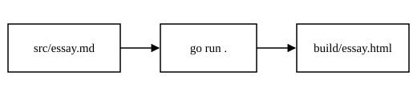

::: toc

- [Why small tools](#why-small-tools)
- [How it works](#how-it-works)
  - [Reading the source](#reading-the-source)
  - [Running it](#running-it)
- [Showing things](#showing-things)
  - [A figure](#a-figure)
  - [A canvas](#a-canvas)
- [Links and notes](#links-and-notes)
- [Writing each piece](#writing-each-piece)
  :::

## Why small tools

Most of the software I use is larger than my need for it.[^1] A tool that does one job is easier to read, easier to trust, and easier to throw away. It also weighs almost nothing: a page like this one comes to a few kilobytes, and a kilobyte is 2^10^ bytes in the old convention.

The idea is older than most of the tools that follow it:

> Write programs that do one thing and do it well. Write programs to work together.
> — Doug McIlroy[^2]

There is also an older piece of advice about timing, which applies to software as much as to anything else:

::: scripture Ecclesiastes 3:1–2
^1^To every thing there is a season, and a time to every purpose under the heaven: ^2^A time to be born, and a time to die; a time to plant, and a time to pluck up that which is planted;
:::

Build what the season needs. When it passes, build something else.

## How it works

The converter reads every Markdown file in `src/` and writes an HTML page for each one into `build/`. The stylesheet, scripts and images are written straight into `build/` by hand, so nothing is copied. Each run deletes the old HTML first, which keeps `build/` an exact mirror of `src/`. It is two Go files and nothing but the standard library.

### Reading the source

The parser walks the file line by line. Each line decides what kind of block it begins: a heading, a quote, a list, a fence, or, failing all of those, a paragraph. Inline markup is handled afterwards, one block at a time. Here is one of the smallest helpers, which decides whether a link counts as external:

```go
func isExternal(href string) bool {
	return strings.HasPrefix(href, "http://") ||
		strings.HasPrefix(href, "https://")
}
```

Only external links are affected by the `-newtab` flag. Links to your own sections always stay in the same tab.

### Running it

From the project folder, one command builds the pages and starts a static server:

```terminal
$ go run . -newtab
src/essay.md -> build/essay.html
serving build on http://localhost:8080
```

Open that address in a browser. For hot reload while writing, run `air` instead and open port 8090.

## Showing things

### A figure

An image on a line of its own becomes a figure. The text in quotation marks after the path becomes the caption.



### A canvas

A canvas block names an element and a script. The script lives in `build/` beside the page and is loaded right after the canvas, so it can find the element by its id.

::: canvas
id=wave width=520 height=220
script=canvas-demo.js
label="A moving sine wave"
caption="Figure 2. A canvas, driven by canvas-demo.js."
:::

The script is plain JavaScript in `build/canvas-demo.js`. The converter never reads it.

## Links and notes

Links open in the same tab unless told otherwise. [The Go documentation](https://go.dev/doc/){new} opens in a new tab because of the `{new}` flag after it. [The regexp package](https://pkg.go.dev/regexp) follows the default, which is the same tab unless the page is built with `-newtab`. And [a link back to the first section](#why-small-tools) never leaves the page.

Superscripts such as 10^3^ are written between carets. Footnotes are written as `[^1]`, numbered in the order they are first cited, and gathered at the bottom of the page with a link back to the sentence that cited them.

## Writing each piece

Everything above is written like this. The table of contents is a list you maintain by hand, wrapped in a `toc` block; add `open` to start it expanded.

```markdown
::: toc open

- [A header](#a-header)
  :::

## A header

### A sub-header

> A quote.
> — Its author

::: scripture Ecclesiastes 3:1–2
^1^To every thing there is a season…
:::


::: canvas
id=wave width=520 height=220
script=canvas-demo.js
:::

2^10^ is a superscript.[^1]

[A link](https://example.com){new}
[Stay here](https://example.com){same}

[^1]: The text of the note.
```

Code goes in an ordinary fence with a language after the opening backticks. Terminal output goes in a fence labelled `terminal`, where any line beginning with `$ ` is drawn as a typed command.

[^1]: This essay is the test file for the converter. Every feature it supports appears somewhere on this page.

[^2]: Doug McIlroy, as quoted in Peter H. Salus, _A Quarter Century of Unix_ (1994).
